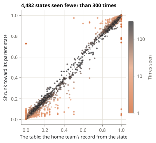

<!-- Built by `whiff-lab notes` from notes/03-shrinkage.md: edit that file, not this one. -->

# Step 2: borrow strength (empirical Bayes)

A state seen four times tells us something, just not much. The fix is not to throw its record away but to mix it with something steadier: a related state with far more games behind it. This is shrinkage, and choosing how much to shrink from the data itself is called empirical Bayes.

## The idea

Take the state "top of the 8th, two outs, runners on second and third, home team up 4". Its own record is thin. Its *parent*, the same inning, half, outs and score with any runners, has hundreds of times more games. Runners matter, so the parent is not the right answer either; but it is a good starting guess.

Mix the two:

```
shrunk rate = (w + k · m) / (n + k)
```

`w` home wins in `n` games from the state, `m` the parent's rate, and `k` a strength: the parent counts like `k` extra games. A state with `n` much bigger than `k` keeps its own record; a state with `n` much smaller than `k` takes its parent's.

## Choosing k from the data

If `k` is too small, rare states stay noisy; too big, and real differences between states get washed out. Empirical Bayes picks `k` by asking which value makes the records we actually saw most likely.

Suppose each state's true rate is drawn from a Beta distribution centred on its parent's rate, with strength `k`, and its record is a binomial draw from that true rate. Then each state's record has a known probability for every `k` (the beta-binomial distribution). Multiply over all states, and pick the `k` with the highest product. No test data is used: the spread of the states' records around their parents is what tells us how much they really differ.

## A ladder of parents

The lab shrinks in four levels, each toward the one above it:

| Level | Groups states by | Fitted k |
| --- | --- | --- |
| 1 | half, score | 0.7 |
| 2 | inning, half, score | 35.9 |
| 3 | inning, half, outs, score | 465.7 |
| 4 | the full state (with runners) | 59.8 |

The numbers are telling. At level 3 `k` is large: once you know the inning, half and score, knowing the outs moves the odds only a little, so a level-3 group needs hundreds of games before its own record wins out. At level 4 it is about 60: runners matter more, and a full state's own record takes over after a few dozen games.



Each dot is a state seen fewer than 300 times in training. On the dashed line, shrinking changed nothing. The orange dots (seen once or a few times) are pulled hard toward their parent's rate: a record of 0% or 100% from a game or two ends up wherever the parent state says. The dark dots (seen a hundred times or more) barely move.

## Result

| Model | Log loss, all | Rare states |
| --- | --- | --- |
| Lookup table | 0.4671 | 0.1526 |
| Shrunk table | 0.4670 | 0.1393 |

Overall the gain is a hair, but it is real: resampling the test games, the shrunk table's log loss minus the table's lies between -0.00019 and -0.00010 (95%), below zero every time. On rare states the gain is 9%. Shrinking costs nothing where data is plentiful and helps where it is thin, which is why the same idea comes back for the eras (lab note 6).

**Next:** [Step 3: a formula](04-logistic.md).
