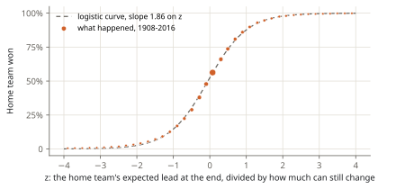

<!-- Built by `whiff-lab notes` from notes/04-logistic.md: edit that file, not this one. -->

# Step 3: a formula (logistic regression)

The table and the shrunk table store one number per state, about nine thousand in all. This step throws the table away and asks: can a handful of numbers, built from what a fan knows about baseball, do the same job?

## Three things a fan knows

**How many runs the batting team can expect before the inning ends.** That depends only on the runners and the outs, and the data gives it directly: from every state of innings 1 to 8, the runs the batting team scored before the third out, on average (1908-2016).

| Runners | 0 out | 1 out | 2 out |
| --- | --- | --- | --- |
| Bases empty | 0.50 | 0.26 | 0.10 |
| First | 0.88 | 0.52 | 0.22 |
| Second | 1.13 | 0.70 | 0.33 |
| First and second | 1.53 | 0.94 | 0.45 |
| Third | 1.38 | 0.96 | 0.38 |
| First and third | 1.78 | 1.19 | 0.52 |
| Second and third | 2.01 | 1.43 | 0.62 |
| Bases loaded | 2.38 | 1.60 | 0.78 |

This is the run expectancy table, one of the oldest tools of baseball analysis. A fresh inning is worth about half a run.

**How much game is left.** Each team has so many half-innings still to bat, and each is worth, on average, a fresh inning's runs.

**How many runs a season scores.** Half a run per inning in 2016 is not half a run in 1930. Each season's numbers are scaled by its runs per game.

## One number: z

Put them together into the lead the home team can expect at the end:

```
expected lead = lead now
              + the batting team's expected runs for the rest of this inning (+ for home, - for visitors)
              + a fresh inning's runs × (home half-innings left - visitors' half-innings left)
```

How sure is that? Runs come in bunches, so the uncertainty grows with the time left: roughly with the square root of the half-innings still to play. Divide one by the other:

```
z = expected lead / √(half-innings left × run scale + 0.25)
```

A big `z` means a lead that is big compared with what can still change.



Every orange dot is a group of plate appearances with about the same `z`. They lie on an S-shaped curve: that is the shape a logistic regression draws.

## The regression

Logistic regression says the log-odds of a home win are a weighted sum of a few inputs:

```
log(p / (1 - p)) = a + b₁·z + b₂·(expected lead) + b₃·(tie, bottom half) + b₄·(tie, 9th or later) + b₅·(z in the 9th or later)
```

The last three inputs let the formula bend where baseball is lumpy: a tie in the bottom half, when the home team can walk off; the 9th inning and later, when there is no "rest of the game" left. The weights are fitted to the counts by maximum likelihood (the same log loss as in the test, minimised on the training years):

| Weight | Value |
| --- | --- |
| a (intercept) | 0.110 |
| b₁ (z) | 2.076 |
| b₂ (expected lead) | -0.068 |
| b₃ (tie, bottom) | -0.025 |
| b₄ (tie, 9th+) | -0.156 |
| b₅ (z, 9th+) | -0.193 |

Six numbers instead of nine thousand. `z` does nearly all the work.

## The rule it knew in advance

Since 2020, an extra inning starts with a runner on second. The formula can be told so: in the 10th, the home team's coming half-inning is worth what a runner on second with nobody out is worth (1.13 runs), not a fresh inning's 0.50. No data needed. The table and the shrunk table, fitted on games before 2020, have never seen the rule.

## Result

| Model | All | Rare states | Extra innings since 2020 |
| --- | --- | --- | --- |
| Lookup table | 0.4671 | 0.1526 | 0.5739 |
| Shrunk table | 0.4670 | 0.1393 | 0.5695 |
| Logistic regression | 0.4683 | 0.1371 | 0.5503 |

On average the formula is a touch worse than the table: six numbers can't capture every quirk of nine thousand states (in the 9th inning especially, where it scores 0.2270 against the table's 0.2173). But it is the best of the three on rare states, where it never says 0% or 100% from four games, and by far the best in the extra innings since 2020, 4% better than the table, because it was told the new rule. A model built on understanding can be right about situations no data has shown it yet.

**Next:** [Step 4: trees](05-boosting.md).
