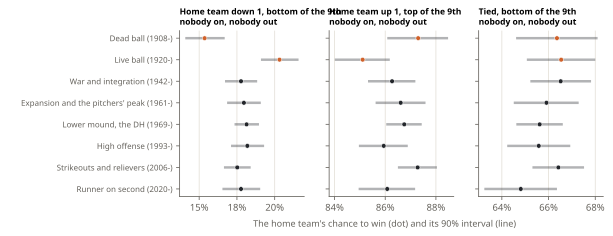
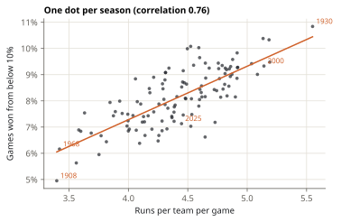

<!-- Built by `whiff-lab notes` from notes/06-eras.md: edit that file, not this one. -->

# Eras: what changes, and what doesn't

Baseball in 1910 and baseball in 2010 are not quite the same game. Scoring has swung from 3.40 runs per team per game (1908) to 5.58 (1930), the ball, the parks and the strategy have changed, and since 2020 even the rules of extra innings. Does a two-run lead in the 7th mean something different in each era?

## The eras

| Era | Seasons | What marks it | Games used |
| --- | --- | --- | --- |
| Dead ball | 1908-1919 | a soft, overused ball; bunts, steals and few home runs | 13,833 |
| Live ball | 1920-1941 | the spitball banned, a cleaner ball, Ruth: runs and home runs boom | 25,122 |
| War and integration | 1942-1960 | wartime rosters, then Robinson and the color line broken | 21,408 |
| Expansion and the pitchers' peak | 1961-1968 | new teams, a bigger strike zone, 1968's 3.4 runs | 12,637 |
| Lower mound, the DH | 1969-1992 | the mound lowered in 1969, the AL's designated hitter in 1973 | 48,181 |
| High offense | 1993-2005 | expansion, small parks and big hitters: the most runs since the 1930s | 29,758 |
| Strikeouts and relievers | 2006-2019 | testing, harder throwers, deeper bullpens, more strikeouts | 33,922 |
| Runner on second | 2020-2025 | extra innings start with a runner on second; the pitch clock from 2023 | 12,784 |

The borders are the usual ones of baseball history, not something the data chose. They matter less than they look: every era's numbers lean on the others (below).

## Does knowing the era help? A test

Leave one era out, fit the models on all the others, and score them on the era left out. The logistic regression is told the left-out era's scoring level (its run scale); the table and the trees are not. If eras mattered a lot, the model that knows the run environment should win.

| Era left out | Runs per game | Table | Logistic (knows the era's scoring) | Trees | The era's own table (unfair) |
| --- | --- | --- | --- | --- | --- |
| Dead ball | 3.84 | 0.4744 | 0.4754 | 0.4741 | 0.4702 |
| Live ball | 4.84 | 0.4767 | 0.4775 | 0.4772 | 0.4739 |
| War and integration | 4.36 | 0.4768 | 0.4781 | 0.4770 | 0.4745 |
| Expansion and the pitchers' peak | 4.02 | 0.4826 | 0.4832 | 0.4826 | 0.4793 |
| Lower mound, the DH | 4.23 | 0.4831 | 0.4844 | 0.4833 | 0.4818 |
| High offense | 4.83 | 0.4758 | 0.4768 | 0.4762 | 0.4737 |
| Strikeouts and relievers | 4.49 | 0.4694 | 0.4707 | 0.4695 | 0.4677 |
| Runner on second | 4.48 | 0.4682 | 0.4690 | 0.4683 | 0.4640 |

The surprise: knowing the era's scoring level did not help. In every era, the table built from the *other* eras is as good as the formula that was told how many runs the era scored, or better. The last column is unfair on purpose (the era's own table, scored on its own games, has memorised them); it marks how much room there is at most, and it is small, a few thousandths.

So the plain answer is: **the odds of a given spot are nearly the same in every era.** A lead is worth about what it was worth a century ago.

## Where the eras do differ

"Nearly" hides a few real differences. To see them, each era's own record is combined with the final model (fitted on all eras) by empirical Bayes, as in step 2: an era moves away from the model only as far as its own games show it should. The fitted strength `k` is between 421 and 1761 games, depending on the era: a spot needs several hundred games in an era before its own record outweighs the model.

The clearest case is the late comeback. A home team down a run in the bottom of the 9th, nobody on, nobody out, won 15.4% of the time in the dead-ball era and 20.3% in the live-ball era that came right after; the 90% intervals don't overlap. Fewer runs, fewer comebacks.

## Comebacks follow the runs

That points to a wider pattern. For every game, the lab finds the lowest chance the winner had at any point. 8.1% of all games were won by a team that was below 10% at some point. By season, that share moves with scoring:

Correlation 0.76 over 118 seasons. The top season was 1930 (10.8% of games won from below 10%), the lowest 1908 (5.0%) and, after the dead-ball years, 1968, the year of the pitcher (6.2%). The odds of a single spot hardly change between eras; how often a game *passes through* a hopeless-looking spot and gets out of it does, because more runs mean more big innings.

## The runner on second

Since 2020 every regular-season extra half-inning starts with a runner on second. It shortened extra innings (71% of extra-inning games now end in the 10th, against 44% from 1908 to 2019) and it moved the odds: with the visitors' runner on second, a tie at the start of the 10th is 49.4% for the home team, against 52.3% with the bases empty before. The home team won 52.4% of extra-inning games before the rule and 50.0% since (90% interval 47.5% to 52.4%, 1,125 games): the edge of batting last may be gone, though a handful of seasons can't settle it.

## What the lab can't see

- **Who is playing.** The model knows the state, not the teams: a 3-run lead is worth more for a team with a great bullpen. Its odds are for an average team against an average team of the era.
- **The park, the weather, the pitcher's pitch count.** Not in the model.
- **Games before 1908, postseason games, and Retrosheet's "deduced" games** (reconstructed from newspaper accounts with partial play-by-play): left out for now.
- **The calculator's intervals** say how sure the combination of an era's record and the model is about the long-run rate in that spot. They are not a forecast of how sure anyone could be about one particular game.

The odds for every spot and every era are in the [calculator](../site/odds/), and every number in these notes is rebuilt from the data once a year.
